  

  

  

  
  

  
  

  
  

  

  

  
  

  

  

## Licence

Copyright © 2026 Dev Patel and Nirjar Patel.

The code in this repository is free software under the [GNU Affero General Public License v3.0](LICENSE)
(AGPL-3.0-only). You may use, change and share it. If you run a changed copy as a website or service,
you must publish your changes under the same licence.

Not covered by this licence:

- **The name and logo.** "Transit Regina" and the Transit Regina logo are not licensed for reuse.
- **Transit data.** Routes, stops and schedules come from [Open Regina](https://openregina.ca) under the
  [Open Government Licence – City of Regina](https://www.regina.ca/city-government/open-data/open-government-licence/).
  Live bus positions come from Regina Transit's TransitLive.
- **Third-party files and services.** Google Maps and other outside services keep their own terms.

  
  

  

  
  
  

